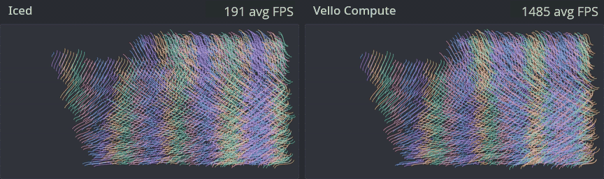

# iced_vello_canvas

A native canvas widget for [Iced 0.14](https://iced.rs/) that rasterizes paths
and text with [Vello Compute](https://github.com/linebender/vello) on Iced's
existing WGPU device. The crate implements a subset of
`iced::widget::canvas` and retains raster output across redraws and panning.



## Getting started

Build the examples from a checkout of this repository. To use the widget in an
app, pair the Git dependency with the released Iced crate.

```toml
[dependencies]
iced = "0.14"
iced_vello_canvas = { git = "https://github.com/aneeshthunga26/iced_vello_canvas" }
```

For a canvas program using the supported API, import this crate as `canvas`.

```rust
use iced_vello_canvas as canvas;
```

Keep the usual `canvas::Program<Message>` implementation, `Frame::new(renderer,
bounds.size())` and `Vec<canvas::Geometry>` return value. Add the widget to your
view using `canvas::Canvas::new(program)` or `canvas::canvas(program)`.

- [Basic example](examples/basic.rs) draws a circle in an Iced window.
- [Comparison example](examples/comparison.rs) draws the same scene in Iced
  and Vello. Left-click either canvas to zoom and right-click to change path
  density.
- [Bézier FPS example](examples/bezier_fps.rs) animates 1,000, 3,000 or 10,000
  cubic Bézier strokes per canvas.

```sh
cargo run --locked --example basic
cargo run --locked --release --example comparison
cargo run --locked --release --example bezier_fps
```

The Bézier example switches between **Iced** and **Vello Compute** in the same
viewport, using the same animated paths. **Avg FPS** divides all completed
redraw intervals by their total elapsed time and refreshes about twice a
second. Changing the renderer, curve count, or viewport size starts a new
average. The example requests VSync off, though your compositor or GPU backend
may still limit the redraw rate.

## Compatibility

Use Iced 0.14 with its WGPU renderer (wgpu 27) and a native compute-capable
adapter. Vello 0.7 applies area antialiasing. On Linux the default `x11` feature
enables Iced's X11 support. For a Wayland-only build, use:

```sh
cargo run --locked --no-default-features --features wayland --example basic
```

| API | Supported operations |
| --- | --- |
| `Canvas` and `Program` | Width and height, custom themes, per-widget state, input events, actions and cursor interactions |
| `Frame` | Filled and stroked paths and rectangles, linear gradients, winding rules, dashes, text, transforms and rectangular clips |
| `Cache` and `Geometry` | Size- or bounds-based caching, explicit invalidation with `Cache::clear` and fixed raster regions for panning |

Text uses Iced's loaded fonts and shaping, follows transforms and clipping, and
paints in call order. Variable font axes and synthetic font styles are outside
the supported subset. Frame transforms use logical pixels and radians. Scaling
transforms stroke paths while keeping logical stroke widths. A clipped child
frame starts with an identity transform in canvas coordinates.

`Cache::with_group`, renderer type parameters on geometry/frame/cache, images
and SVG are outside the supported subset. TinySkia, WebGL and browser WebGPU
are unsupported. Vello initialization and rendering errors currently panic.

## Development

```sh
cargo fmt --all --check
cargo test --locked
cargo test --locked --lib -- --include-ignored
cargo check --locked --all-targets
cargo package --locked
```

The `--include-ignored` command runs offscreen pixel tests on a native
compute-capable adapter. They cover clipping, alpha blending, text, large
drawing crops, and retained regions during panning and DPI changes.

Run the compute curve benchmark with `cargo bench --locked --bench curves -- 48 1000`
for 48 measured frames per repetition and a 1,000 FPS cap. Omit the cap for
uncapped runs.

## License

[MIT](LICENSE), including the notice for the widget lifecycle and program API
adapted from Iced.
